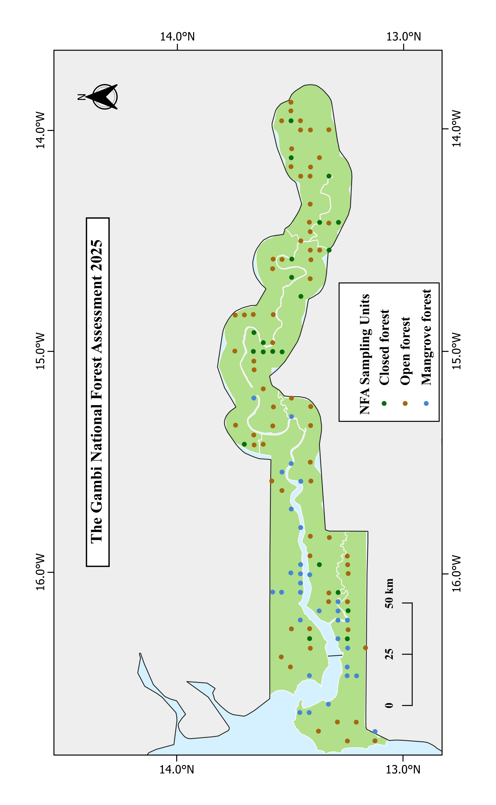
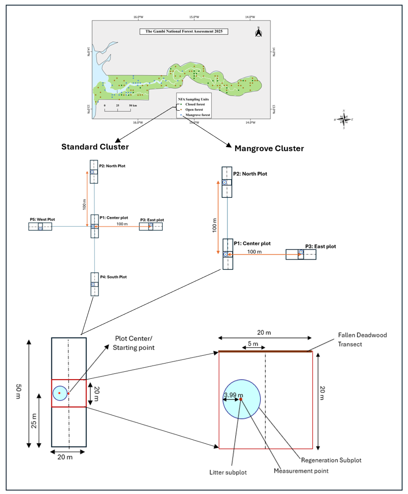

<!-- Substantive analytical choices remain for Gael to review in the comments below
 -->

# Report preparation notes {#sec-report-preparation-notes .unnumbered}

This working outline follows the table of contents agreed with the Department of Forestry (DoF). The Results Framework Matrix is reproduced in the annexes. Narrative, tables, figures and references will be added as drafting and analysis progress.

**Reporting levels requested by DoF:** present applicable estimates for the whole forest nationally, by region, and by stratum. The regions are Western, Lower River, North Bank, Central River and Upper River; the strata are Closed forest, Open forest and Mangrove.



# Cover page {#sec-cover-page .unnumbered}

[Cover design, logos and publication details to be added.]



# Front page {#sec-front-page .unnumbered}

**Funding through**

Government of The Gambia --- Environment Climate Change and Natural Resources (MECCNAR)

Food and Agriculture Organization of the United Nations (FAO)

**Implementing agencies**

Department of Forestry (DoF) --- The Gambia

**Advisory and technical supervision**

FAO Forest Management and Monitoring Team

**Report compilation**

\[Insert FAO and DoF contributors\]

# Foreword {#sec-foreword .unnumbered}

The forests of The Gambia are an essential national resource. They support rural livelihoods, provide wood and non-timber forest products, conserve biological diversity, and contribute to soil protection, water regulation and climate resilience. Maintaining these benefits requires informed decisions about how forests are managed, protected and used.

The fourth National Forest Assessment provides an updated information base for these decisions. Building on previous national assessments, it brings together information on forest extent, species composition, forest structure, regeneration, health and disturbance, biomass and carbon stocks, and other forest resources. It also reflects national information priorities identified through consultation with the Department of Forestry and other stakeholders.

This report presents the inventory methodology and findings to support forest policy, planning, conservation and sustainable management. Results are presented nationally and by forest stratum, with regional breakdowns provided where relevant. The information is intended to assist government institutions, forest managers, communities, researchers and development partners in identifying management needs and directing action where it is most useful.

Beyond the information produced, the inventory contributes to strengthening national capacity for forest assessment and monitoring. The use of digital data collection, documented quality-control procedures and reproducible data preparation and analysis provides a foundation for future assessments and continued improvement of the national forest information base.

The Government of The Gambia recognises the contributions of all institutions, technical partners, field personnel and communities involved in this undertaking. Their collaboration has been essential to the implementation of the inventory.

The value of this work will be realised through the use of its findings. We encourage all stakeholders to draw on the report in planning and implementing actions that conserve forest resources, sustain their productive and protective functions, and support the well-being of the people who depend on them.

Name ...................

Official title............

# Acknowledgements {#sec-acknowledgements .unnumbered}

The Department of Forestry acknowledges the contributions of the institutions and individuals who supported the planning, implementation and reporting of the fourth National Forest Assessment of The Gambia.

Appreciation is extended to the Government of The Gambia, through the Ministry of Environment, Climate Change and Natural Resources, for its leadership and institutional support. The Department also acknowledges the Food and Agriculture Organization of the United Nations for its technical assistance and support throughout the inventory process.

Special thanks are due to the national and international technical specialists who contributed to the inventory design, field methodology, training, digital data-collection system, quality assurance and quality control, data preparation, analysis and report development. Their collaboration with Department of Forestry staff supported the application of consistent procedures across the different stages of the inventory.

The commitment of the field teams and supervisors is gratefully acknowledged. Their work in locating sample sites, identifying species, recording observations and undertaking measurements under varied field conditions was central to the collection of the inventory data. Appreciation is also extended to the personnel who coordinated field operations, provided logistical support, and assisted with data management and verification.

The Department thanks the local authorities, community representatives, forest managers, guides and resource users who facilitated access to sample locations and supported field activities. Their knowledge of local conditions and forest resources contributed to the implementation of the inventory.

Finally, appreciation is extended to the stakeholders and reviewers who helped define the information priorities and provided comments on the inventory methods and reporting framework.

***Specific funding acknowledgements, institutional credits and individual contributors to be confirmed by DoF.***

# Executive Summary {#sec-executive-summary .unnumbered}

# List of Tables {#sec-list-of-tables .unnumbered}

@tbl-1 — NFA criteria, indicators and targeted outputs

@tbl-2 — Forest strata and their descriptions

@tbl-3 — Distribution of selected sample units by forest stratum

@tbl-4 — Sampling unit specifications

@tbl-5 — Field inventory equipment and uses

@tbl-6 — Diameter measurement procedures for different tree cases

@tbl-7 — Measurement plot areas and scaling factors for tree attributes

@tbl-8 — Phase-one CEO sample counts, stratum weights and estimated class areas

@tbl-framework — NFA Results Framework Matrix

# List of Figures {#sec-list-of-figures .unnumbered}

@fig-1 — Geographical distribution of the 120 selected NFA clusters by forest stratum

@fig-2 — Cluster, plot, and subplot design

# Acronyms and Abbreviations {#sec-acronyms-and-abbreviations .unnumbered}

# Introduction {#sec-introduction}

## Background (DoF to write) {#sec-background-dof-to-write}

Forests are an important component of The Gambia's natural resource base and contribute to the environmental conditions on which livelihoods and economic activities depend. They provide fuelwood, construction materials, food, medicines and other forest products, while supporting biodiversity, protecting soils and contributing to water and climate regulation. These functions are particularly important in rural areas, where households depend on forest resources alongside agriculture and livestock production.

Much of The Gambia lies within the Sudano-Sahelian agro-ecological zone and is characterised by a pronounced dry season and woodland savannah vegetation. The country's forest resources also include mangrove ecosystems associated with the River Gambia and its estuarine environments. Differences in environmental conditions, species composition and patterns of resource use create distinct management needs across these forest ecosystems.

The continued provision of forest goods and services is affected by pressures on the extent and condition of forests. Unsustainable harvesting, including the selective removal of high-value species such as *Pterocarpus erinaceus*, together with agricultural expansion, settlement and infrastructure development, can alter forest composition, structure and regeneration. Land degradation and desertification further underline the importance of maintaining the protective functions of forests.

Forest management in The Gambia has also evolved through the development and expansion of participatory approaches. These approaches place greater emphasis on the involvement of communities and other stakeholders in managing forest resources. Reliable information is therefore needed both for national planning and for decisions concerning the management, conservation and sustainable use of individual forest areas.

Previous national forest inventories were conducted in 1981/82, 1997/98 and 2009/10. These assessments provided important information for forest management and reporting. However, the time elapsed since the most recent assessment, together with continuing pressures on forest resources and evolving information needs, made an updated inventory necessary.

The fourth national assessment builds on this earlier work while introducing improvements to the sampling design, field procedures, inventory tools and data management. The variables collected were reviewed through consultation with the Department of Forestry and other stakeholders to focus on national forest management priorities and international reporting needs.

The assessment was undertaken under the leadership of the Ministry of Environment, Climate Change and Natural Resources, through the Department of Forestry, with technical support from FAO. This report presents the methodology and findings of the National Forest Assessment (NFA).

## Rationale and Objectives of the National Forest Assessment {#sec-rationale-and-objectives-of-the-national-forest-inventory}

Effective forest management requires reliable information on the extent, composition, condition and productive capacity of forest resources. Without an updated information base, it is difficult to identify management priorities, assess conservation needs, plan sustainable resource use or report consistently on the status of forests.

The need for the current inventory arose from the age of the previous national assessment and the changes in forest use and management that have occurred since it was conducted. Updated information is required to support the National Forest Programme, guide the implementation of participatory forest management, and inform responses to forest degradation and other pressures on forest resources.

The inventory also responds to the need for a more consistent and accessible national forest information base. An agreed set of variables, supported by standardised field procedures, digital data collection, quality-control measures and documented analytical methods, provides a basis for producing information that can be reviewed, used and updated.

The overall goal of the NFA is to support the National Forest Programme in advancing sustainable natural resource management and improving rural livelihoods through better forest management and efficient, cost-effective forestry activities.

The direct objective is to generate reliable, up-to-date information on forest resources to support policy formulation, institutional capacity building, planning, conservation and the sustainable use of natural resources. The information will also contribute to international reporting, including FAO's Global Forest Resources Assessment, forest-related greenhouse gas reporting under the United Nations Framework Convention on Climate Change (UNFCCC), and biodiversity reporting under the Convention on Biological Diversity (CBD).

## Scope of the National Forest Assessment {#sec-scope-of-the-national-forest-inventory}

The NFA covers forest areas across The Gambia within and outside designated forest reserves and forest parks. Its coverage encompasses the three forest strata used in the inventory design: Closed forest, Open forest and Mangrove. Trees outside forests are not included.

The inventory combines information from the Collect Earth Online (CEO) forest classification exercise with observations and measurements collected in the field. The CEO exercise provides information on current forest extent and forest-type classification, while the field inventory provides more detailed information on forest composition, structure, condition and associated resources.

The inventory provides biophysical information to support forest management and policy decisions. Its findings can inform actions relating to livelihoods and resource use, although the inventory does not directly quantify household dependence on forests or the economic value of forest goods and services.

The inventory scope includes:

-   Tree species identity, dimensions, status and condition.

-   Forest regeneration, including seedlings and saplings.

-   Fallen deadwood, standing dead trees and stumps.

-   Litter and recorded soil characteristics.

-   Forest disturbances and evidence of resource use.

-   Non-timber forest products and their recorded uses and availability.

-   Wildlife observations and signs of occurrence.

-   Biomass and carbon stocks estimated from tree and deadwood measurements

## NFA Criteria, Indicators and Targeted Outputs {#sec-nfi-criteria-indicators-and-targeted-outputs}

The NFA reporting framework is organised around five criteria: extent of forest resources, biological diversity, forest health and vitality, productive functions of forests, and protective functions of forests. These criteria provide a structure for linking the information collected to the questions the inventory is intended to address.

Within this framework, a **criterion** represents a broad aspect of forest resources or their functions. The associated **indicators** identify the characteristics assessed, while the **targeted outputs** specify the estimates, summaries, lists and spatial information to be produced.

The framework reflects the information priorities identified through consultations with the Department of Forestry and other stakeholders. These priorities guided the development of the NFA methodology and the selection of variables for field data collection, which were streamlined to focus on those most relevant for national forest management priorities and international reporting needs. The framework also guides the analysis and organisation of the Results and Discussion chapter.

| **Criterion**                          | **Indicators covered**                                                                                                              | **Targeted outputs**                                                                                                                                                                                                                                                                                                       |
|------------|----------------------|--------------------------------------|
| **1. Extent of forest resources**      | Current forest area and distribution                                                                                                | Estimated forest area in hectares; percentage of land area under forest; area by forest stratum; and spatial distribution of forests.                                                                                                                                                                                      |
| **2. Biological diversity**            | Tree species composition and richness; occurrence of rare, threatened and endangered tree species; wildlife presence and occurrence | Tree species lists; abundance and frequency summaries; species richness and diversity indices; conservation-status summaries and occurrence of species of conservation concern; wildlife taxa or species lists; and summaries of direct observations and recorded signs.                                                   |
| **3. Forest health and vitality**      | Tree health and condition; forest disturbance; deadwood and litter characteristics; forest structure; forest regeneration           | Summaries of crown and overall tree condition, recorded damage and its causes; disturbance occurrence and intensity; deadwood quantity, volume and decomposition; litter characteristics; stems and basal area per hectare; diameter and height distributions; and seedling and sapling density, richness and composition. |
| **4. Productive functions of forests** | Non-timber forest products; forest biomass and carbon stocks                                                                        | NTFP lists, occurrence, richness, use categories and recorded availability; living-tree biomass per hectare and total biomass; deadwood biomass; and associated carbon-stock estimates.                                                                                                                                    |
| **5. Protective functions of forests** | Recorded soil condition and characteristics                                                                                         | Summaries of soil surface condition, depth, topsoil and subsoil texture, and soil colour, providing information on site conditions relevant to forest management.                                                                                                                                                          |

: NFA criteria, indicators and targeted outputs {#tbl-1}

The selected indicators describe the aspects of each criterion covered by the inventory. They provide information for interpreting forest conditions and management needs, rather than a complete assessment of every ecological, social and economic dimension of sustainable forest management.

The detailed NFA Results Framework Matrix in Annex I links each indicator to its analytical outputs and corresponding report section.

# NFA Methodology {#sec-nfi-methodology}

## Sampling Design {#sec-sampling-design}

### Selection and Distribution of Sample Units {#sec-selection-and-distribution-of-sample-units}

The NFA used a stratified sampling design to ensure representative and efficient sampling across different forest types. The sampling process followed a two-phase approach. The first phase involved satellite image interpretation to establish the forest sampling frame. The second phase involved the allocation and selection of sample units, referred to as clusters, for field inventory.

The sampling frame combined the systematic 5-arcminute grid used in the previous NFA with a new established 2.5-arcminute intensification grid. The previous 5-arcminute grid comprised 152 sample units distributed nationwide across both forest and non-forest areas. As the current NFA focused exclusively on forests, only locations classified as forest following review were retained for sampling. The 2.5-arcminute intensification grid was introduced to supplement the forest locations available from the previous grid. The closer spacing increased the number of potential forest sampling locations while allowing the inventory to maintain continuity with the previous assessment.

Land cover at candidate locations was assessed through visual interpretation of high-resolution satellite imagery in Collect Earth Online (CEO) to distinguish forest from non-forest land according to the national forest definition. The Gambia defines forest as land covering at least 0.5 ha, with tree canopy cover of at least 10% and trees capable of reaching a height of at least 5 m at maturity, excluding land predominantly under agricultural or urban use.

Forest locations were assigned to three sampling strata (@tbl-2). These strata reflect ecological differences in canopy density and species composition, allowing for more accurate estimation of forest parameters across the landscape. Stratification is a critical step in the sampling design, as it improves the precision and efficiency of the inventory by reducing variability within each stratum and ensuring that all major forest types are adequately represented.

| **Forest stratum** | **Description**                                                                                                              |
|-----------|-------------------------------------------------------------|
| Closed forest      | Forest with tree canopy cover greater than 70%, characterised by dense, largely continuous tree crowns.                      |
| Open forest        | Forest with tree canopy cover between 10% and 70%, characterised by more widely spaced trees and discontinuous canopy cover. |
| Mangrove           | Coastal and estuarine forest composed of mangrove species, identified by its vegetation and tidal setting.                   |

: Forest strata and their descriptions {#tbl-2}

Following classification, the sampling frame comprised 201 forest cluster locations: 52 from the previous NFA grid and 149 from the new intensification grid.

In the second phase, sample units were allocated across the forest strata using a hybrid approach combining Neyman allocation (to account for variability across strata) with equal allocation (to ensure a minimum number of samples in each stratum). This approach ensures that strata with higher variability receive adequate sample units, while smaller strata retain a minimum level of representation. Biomass variability estimated from the previous NFA informed the Neyman allocation. Sample-size planning considered a target relative allowable error of 20% for biomass estimation at a 95% confidence level, together with available resources.. The final sample comprised a total of 120 clusters.

All 52 forest locations retained from the previous NFA grid were included in the final sample. These were supplemented by 68 locations from the intensification grid. All 21 Closed forest clusters in the sampling frame were selected. In Open forest, the 39 previous NFA locations were supplemented by 29 randomly selected intensification grid locations. In Mangrove, the seven previous NFA locations were supplemented by 24 randomly selected intensification grid locations.

The distribution of selected clusters by forest stratum is presented in @tbl-3, and their geographical distribution is shown in @fig-1.

| **Forest stratum** | **Number of sample units** |
|--------------------|----------------------------|
| Closed forest      | 21 clusters                |
| Open forest        | 68 clusters                |
| Mangrove           | 31 clusters                |
| **Total**          | 120 clusters               |

: Distribution of selected sample units by forest stratum {#tbl-3}

{#fig-1 height="6.5in"}

### Cluster and Plot Design {#sec-cluster-and-plot-design}

The NFA adopted a cluster sampling unit design. Clusters represented the primary sampling units for field data collection. Each cluster consisted of rectangular plots arranged in fixed spatial configurations:

-   **Closed and Open forest:** The standard cluster layout consisted of five rectangular plots (50 × 20 m) arranged in a cross-shaped configuration, with the centre of each outer plot positioned 100 m from the centre of Plot 1. The plots were numbered starting with the centre (Plot 1), followed by North (Plot 2), East (Plot 3), South (Plot 4) and West (Plot 5).

-   **Mangrove:** Environmental conditions and accessibility pose unique challenges in mangrove forests; therefore, the cluster design was modified. Each cluster consisted of three rectangular plots (50 × 20 m) arranged in an L-shaped configuration. The plots were positioned as Centre (Plot 1), North (Plot 2) and East (Plot 3), with the centres of Plots 2 and 3 each located 100 m from the centre of Plot 1.

The cluster design optimizes operational feasibility while ensuring adequate distance between plots to minimize spatial autocorrelation. The coordinates of the central plot within each cluster represented the sampling unit location selected from the sampling frame and served as the starting point for cluster layout in the field. Each plot contained nested subplots to efficiently capture trees of different size classes, regeneration and litter. In addition, a fallen-deadwood transect and a soil measurement point were included. The sampling unit specifications are summarised in @tbl-4, and @fig-2 illustrates the cluster, plot and subplot layouts.

| **Unit**                       | **Shape**         | **Size (area)**                       | **Number**                                         | **Measurements or information**                                    |
|--------------|----------|----------------|--------------|--------------------|
| Cluster                        | Cross or L-shaped | ---                                   | ---                                                | ---                                                                |
| Main plot                      | Rectangle         | 50 × 20 m (1,000 m²)                  | 5 per cross-shaped cluster; 3 per L-shaped cluster | Trees with DBH ≥20 cm                                              |
| Square subplot (SSP)           | Square            | 20 × 20 m (400 m²)                    | 1 per plot                                         | Trees with DBH ≥10 cm to 19.9 cm                                   |
| Regeneration subplot (RSP)     | Circular          | Radius = 3.99 m (approximately 50 m²) | 1 per plot                                         | Saplings: height ≥1.3 m and DBH \<10 cm; seedlings: height \<1.3 m |
| Litter subplot (LSP)           | Circular          | Radius = 18 cm (approximately 0.1 m²) | 1 per plot                                         | Litter depth and composition                                       |
| Fallen-deadwood transect (FDT) | Line              | 20 m                                  | 1 per plot                                         | Fallen deadwood with small-end diameter ≥10 cm and length ≥1 m     |
| Measurement point (MP)         | Point             | ---                                   | 1 per plot                                         | Soil biophysical properties                                        |

: Sampling unit specifications {#tbl-4}

*Note: All distances are horizontal distances. DBH = diameter at breast height.*

{#fig-2 height="6.5in"}

*Sampling design of the NFA illustrating (top) the spatial distribution of sampling units across The Gambia, (middle) the layout of standard and mangrove forest clusters, and (bottom) the configuration of plots and nested subplots with litter, regeneration, measurement point, and deadwood transect*.

## Field Data Collection {#sec-field-data-collection}

Field data collection involved locating and establishing the sampling units and assessing the variables of interest. Field teams navigated to the pre-assigned plot coordinates using GPS receivers and field maps, with local guides supporting access where necessary. Access routes, reference points and plot coordinates were recorded to facilitate future relocation.

Plots were established from their designated centres using measuring tapes, compasses, ranging poles and flagging tape, following the specifications in @tbl-4 and the layouts in @fig-2. Permanent markers were used to identify plot locations. Where a marker could not be installed at the exact plot centre, its position and the distance and bearing to the centre were recorded. Surrounding reference features were also documented. Plot dimensions and spacing were measured as horizontal distances, with slope corrections applied where necessary.

Land use and land cover within each plot were recorded, including the forest type and the percentage of the plot occupied by each land-use/land-cover category. Field notes and photographs supported the documentation of site conditions, uncertain species identifications and unusual observations.

The measurements and assessments were carried out following the established field protocols described in the Field Manual. Field measurements and observations were recorded using Arena Mobile and paper field forms. Electronic records were submitted to the Open Foris Arena server for review and subsequent data preparation.

#### Field Teams and Inventory Equipment {#sec-field-teams-and-inventory-equipment .unnumbered}

Field data collection was undertaken by six teams, each comprising five core members: a team leader, an assistant team leader/plot demarcator, a tree enumerator, a data recorder and a taxonomist. Each team was supported by an additional locally recruited field assistant. The list of field teams, members and their assigned roles is provided in Appendix \[X\].

The team leader coordinated field activities, community liaison and logistics, supervised measurements and reviewed completed records. The assistant team leader supported navigation, plot establishment and demarcation, equipment management and coordination of the local assistant. The tree enumerator carried out tree, stump and fallen-deadwood measurements, assessed tree condition and undertook soil and litter assessments. The data recorder documented measurements and observations, checked entries for completeness and consistency, and managed field records and electronic data submission. The taxonomist led species identification, regeneration assessment and observations of NTFPs and wildlife. Local assistants supported access to cluster locations, equipment transport and plot demarcation, and contributed knowledge of local species names and field conditions.

Before the field inventory, field team members received practical training in the NFA methodology, field protocols, data recording and the use of inventory equipment. Their competence in using the equipment and carrying out the required field procedures was assessed, and members were certified before deployment. A refresher training was conducted immediately before field data collection commenced to reinforce the procedures and promote consistent application across teams. QA/QC supervisors also received training and accompanied field teams to conduct hot checks (observations and checks made while fieldwork was in progress) and provide practical guidance. The supervision arrangements are described in @sec-quality-assurance-and-quality-control.

The principal inventory equipment and its uses are summarised in @tbl-5.

| Equipment | Use in the inventory |
| --- | --- |
| GPS receiver Garmin GPSMAP 64sx | Navigation to sampling locations and recording plot, marker and reference-point coordinates. |
| Suunto Compass/Clinometer | Determining bearings, aligning plot boundaries and measuring slope. |
| Measuring Tape (50 m) | Establishing plots and subplots, measuring distances and recording fallen-deadwood length. |
| Diameter Tape (5 m) | Measuring tree and stump diameters. |
| Haglöf Mantax Blue Caliper | Measuring diameters, including the small and large ends of fallen deadwood. |
| Haglöf Vertex IV hypsometers with transponders | Measuring tree height |
| Ruler | Measuring litter depth and soil organic-layer thickness. |
| Tablets with Arena Mobile | Recording field measurements and observations and taking photographs. |
| Paper field forms, notebooks and writing materials | Backup for data recording, field notes, sketches and reference information. |
| Ranging poles and coloured flagging tape | Aligning and demarcating plot and subplot boundaries. |
| Galvanised metal markers and hammers | Permanently marking plot locations to support future relocation. |
| Chalk | Temporary marking measured trees and stumps to prevent duplicate measurements |
| Machetes | Clearing access and measurement paths and assessing wood decomposition using the machete test. |
| Field maps, satellite images and the field manual | Supporting navigation, field planning and consistent application of inventory procedures. |
| Protective and safety equipment | Supporting safe fieldwork, including boots, gloves, goggles, raincoats, first-aid kits and life jackets |

: Field inventory equipment and uses {#tbl-5}

### Soil Assessment {#sec-soil-assessment}

Soil biophysical properties were assessed at the designated measurement point at the centre of the regeneration subplot using the rapid Visual Soil Assessment (VSA) methodology of FAO (FAO, 2008). The assessment covered soil surface condition, organic layer depth, topsoil and subsoil texture, and topsoil colour.

Soil surface condition was classified as poor, moderate or good based on the percentage of bare soil and visible evidence of crusting, compaction, and stoniness. Organic-layer depth was assessed by removing loose surface litter to expose the underlying organic material above the mineral soil. The thickness of this layer was measured using a ruler and recorded as absent, less than 1 cm, between 1 cm and 5 cm, or greater than 5 cm.

Soil texture was assessed at two depths: topsoil at 0--5 cm and subsoil at 5--30 cm. Samples from each depth were moistened and examined by hand. Their grittiness, stickiness, plasticity and ability to form balls or ribbons were used to distinguish sand, sandy loam/loamy sand, loam, clay loam and clay. Rock or laterite was recorded where applicable.

Topsoil colour was observed using a moistened sample in natural daylight and classified as pale brown/greyish, brown/light brown, or dark/very dark brown. Additional observations were recorded in the soil notes. Following assessment, excavated soil was returned and the surface restored as far as practicable.

### Litter Assessment {#sec-litter-assessment}

Litter presence, depth and composition were assessed within the circular litter subplot. Litter comprised dead organic material on the forest floor, including leaves, grasses, herbs, seeds, fruits, twigs and small branches less than 2.5 cm in diameter. Where litter was present, its depth was measured at three evenly spaced points using a ruler or graduated stick, and the average was calculated. Average depth was recorded in three classes: less than 1 cm, between 1 cm and 5 cm, and greater than 5 cm. Where no litter was observed, its absence was recorded. The dominant litter composition was assessed visually and classified as woody or non-woody. Woody litter consisted of twigs and small branches, while non-woody litter included leaves, dead herbs and grasses, seeds and fruits.

### Fallen Deadwood Assessment {#sec-fallen-deadwood-assessment}

Fallen deadwood was assessed along the designated 20 m transect located at the end of the square subplot. Measurements included fallen logs, branches and trees with a small-end diameter ≥10 cm and a length ≥1 m that intersected the transect line through at least half their diameter. Fallen branches were included only where they were on the ground and detached from the tree stem.

For each qualifying piece, the small-end and large-end diameters were measured in centimetres using a calliper, and the length was measured in metres using a measuring tape. Decomposition was assessed using a machete test and classified as sound, intermediate or rotten. Fallen dead wood was considered sound when struck with a machete and it bounces back or left only a surface mark; intermediate when the machete partly penetrated the wood; and rotten when the machete easily penetrated and the wood crumbled.

### Regeneration Assessment {#sec-regeneration-assessment}

Regeneration was assessed by identifying and counting all seedlings and saplings within the circular regeneration subplot. The assessment covered only tree species (species capable of reaching at least 5 m in height at maturity). Seedlings were defined as individuals less than 1.3 m in height, while saplings were individuals at least 1.3 m in height with DBH \<10 cm.

The subplot boundary was clearly marked before enumeration. Enumeration began at the centre of the subplot and the teams moved systematically around the subplot in a consistent direction (e.g. clockwise), identifying species by scientific or common/local names and completing the seedling and sapling counts for one species before proceeding to the next.

### Tree and Stump Measurements  {#sec-tree-and-stump-measurements}

Trees and stumps were assessed within the rectangular main plot and square subplot according to the diameter criteria presented in @tbl-4. Trees with DBH ≥20 cm were measured in the main plot, while those with DBH ≥10 cm to 19.9 cm were measured in the square subplot. Each tree or stump was assigned a unique number within the plot, and its status, plot or subplot location were recorded. The recorded status categories were live tree, standing dead tree and stump. Species were identified using scientific or common/local names. Where identification was uncertain, descriptive notes and photographs supported subsequent verification.

Total tree height was measured using a Haglöf Vertex IV hypsometer, from a position that provided a clear view of the tree top and the mounted transponder. Tree diameter was measured over bark at 1.3 m (diameter at breast height) above ground using a diameter tape positioned perpendicular to the stem axis and in direct contact with the bark. Standard diameter measurement procedures, as presented in @tbl-6, were applied where forks, buttresses, aerial roots, leaning stems or other irregularities affected the standard measurement position, or where a tree was on sloping ground. The actual measurement height was recorded whenever diameter was measured at a height other than 1.3 m above ground.

| **Tree case**                                                                     | **Measurement procedure applied**                                                                                                                                                                                                                                                                                                                                                                                                                                                                                   |
|------------------------------------|------------------------------------|
| **Tree on sloping terrain**                                                       | Diameter was measured at 1.3 m above ground, with the measurement height determined from the uphill side of the tree.                                                                                                                                                                                                                                                                                                                                                                                               |
| **Tree forked below 1.3 m**                                                       | Each stem was considered a separate tree and diameter was measured at 1.3 m above the ground. Each stem was included only if it met the applicable diameter threshold for the plot: ≥20 cm in the main plot or ≥10 cm to 19.9 cm in the square subplot                                                                                                                                                                                                                                                              |
| **Tree forked above 1.3 m**                                                       | The tree was treated as a single tree. Diameter was measured at 1.3 m above the ground, provided the measurement position was unaffected by swelling associated with the fork                                                                                                                                                                                                                                                                                                                                       |
| **Tree forked at or just above 1.3 m**                                            | The tree was treated as a single tree. Diameter was measured below the fork, just beneath any swelling that could inflate the measurement                                                                                                                                                                                                                                                                                                                                                                           |
| **Coppice stems**                                                                 | Coppice stems were assessed using the same rules as forked trees. Where coppice shoots originated below 1.3 m, each stem meeting the applicable diameter threshold was measured separately at 1.3 m above ground. Where shoots originated above 1.3 m, the main stem was measured at 1.3 m                                                                                                                                                                                                                          |
| **Tree with an enlarged stem base or buttresses**                                 | Where the enlarged base or buttresses ended well below 1.3 m and did not affect the measurement position, diameter was measured as usual at 1.3 m. Where the enlarged base or buttresses extended to or above 1.3 m, diameter was measured just above the enlarged or buttressed portion, and the measurement height was recorded.                                                                                                                                                                                  |
| **Tree with aerial roots**                                                        | The transition point between the aerial roots and the regular stem was identified. Diameter was measured 1.3 m above this point along the stem, and the measurement height was recorded                                                                                                                                                                                                                                                                                                                             |
| **Tree with an irregular stem at 1.3 m**                                          | Where bulges, wounds, hollows, branches or other irregularities affected the stem at breast height, diameter was measured just above the irregularity at a point where the stem was not affected. The measurement height was recorded                                                                                                                                                                                                                                                                               |
| **Inclined/leaning tree**                                                         | Diameter was measured 1.3 m along the stem from the base that forms the smallest angle with the ground (the leaning side of the tree)                                                                                                                                                                                                                                                                                                                                                                               |
| **Fallen tree**                                                                   | Diameter was measured 1.3 m along the stem from the transition point between the stem and the roots                                                                                                                                                                                                                                                                                                                                                                                                                 |
| **Living tree lying on the ground with branches in the shape of a vertical tree** | The position of the main stem's pith relative to the litter layer determined how upright branches were assessed. Where the pith was above the litter, forked-tree rules were applied. Where the main stem's pith was below the litter, the main stem was ignored and upright branches were treated as separate trees, with diameter measured at 1.3 m above ground. Where the top of the stem curved vertically from the ground, it was treated as a separate tree and measured 1.3 m from the origin of the curve. |

: Diameter measurement procedures for different tree cases {#tbl-6}

The height, diameter, and decomposition status of stumps were recorded. Stump diameter was measured at 1.3 m or at the top of the stump if it was less than 1.3 m above the ground. In such cases, the height of the stump (where the diameter was measured) was recorded. Stump decomposition was assessed using the machete test and classified as sound, intermediate or rotten

Tree condition assessment for live trees covered stem quality, crown condition, overall condition and visible causes of damage or stress. Stem quality was classified as low, medium or high based on stem form, defects and visible damage. Crown health condition was assessed based on visible symptoms, including foliage abundance or loss, dieback, structural damage and other signs of declining health. Overall condition reflected the severity of visible symptoms affecting tree health and vitality.

Causes of damage or stress listed for field observation included insects, diseases or fungi, fire, animals, human activity and climatic damage; unknown or other causes were recorded where applicable. Trees were also assessed for recommendation as mother trees for seed collection, and only healthy trees were eligible for this recommendation.

Measured trees and stumps were marked with chalk to prevent duplicate recording. A tree located at the border of the plot was considered within the plot and measured if at least half of its stem diameter at breast height was inside the plot. Where the stem centre was positioned exactly on the plot borderline, the tree was also considered inside. However, when one borderline tree had already been included, the next such tree encountered on the borderline was considered outside, (i.e. following an alternating sequence -- one in, one out). When a tree or other feature obstructed the path over which measurement was to be taken, the measurement was broken up into shorter lengths to bypass the obstacle.

### Forest Disturbance Assessment {#sec-forest-disturbance-assessment}

Forest disturbances were assessed through visual observations within the main plot. Teams recorded evidence of grazing, fire, human removal of branches and tree tops, and tree harvesting. The presence or absence of each disturbance was recorded, followed by its intensity where present. Disturbance intensity was classified as low, medium or high according to the extent and severity of visible evidence.

Grazing assessment considered browsing damage, signs on the herbaceous vegetation, animal tracks and dung. Fire assessment considered fire scars, charred stems, ash, burnt stumps and scorched soil surface. Branch and top removal was assessed from cutting marks and damage to tree crowns. Harvesting evidence included stumps, felled logs, cut trunks and sawn timber. Where harvesting was observed, the harvesting method was also recorded. Other disturbances not covered by the predefined categories were specified and described in the field notes.

### Non-Timber Forest Product Assessment {#sec-non-timber-forest-product-assessment}

Non-timber forest products (NTFPs) were observed and recorded within the main plot alongside tree measurements. Teams identified NTFPs using predefined field lists, supplemented by scientific or common/local names and descriptions for those not included in the lists.

Each NTFP observation was assigned one or more use categories: edible, medicinal, craft, resins and oil, or other uses. Multiple categories were recorded where a product had more than one use. Availability within the plot was assessed qualitatively as few, moderate or abundant

### Wildlife Assessment {#sec-wildlife-assessment}

Wildlife assessment combined direct observations with signs of animal presence within the main plot. Observations began on arrival, before plot establishment and other field activities could disturb animals or obscure signs, and continued alongside tree measurements.

Wildlife records were grouped as birds, mammals, reptiles, amphibians, fishes or other animals. Species were identified by common or scientific names where possible. Uncertain observations were supported by descriptions and photographs where practicable.

Evidence or indicator of wildlife presence included visual sightings, calls and other sounds, tracks, faeces, burrows, dens, nests, feeding signs, scratching and claw marks, feathers, trails, holes, diggings, fur, skin and animal remains. More than one type of evidence could be recorded for the same species. Additional field notes documented relevant observations encountered during the plot assessment.

## Quality Assurance and Quality Control {#sec-quality-assurance-and-quality-control}

Quality assurance and quality control (QA/QC) measures were integrated into the preparation, implementation and review of the field inventory to support consistent application of the methodology and improve the accuracy, completeness and reliability of the data. These measures combined standardised field protocols, practical training and certification, field supervision, checks during data collection, and review of submitted records.

The QA/QC team comprised five trained supervisors: three field supervisors and two lead supervisors. Each field supervisor was assigned to two field teams and provided direct supervision and technical support during fieldwork. Supervisors alternated between their two assigned teams, accompanying one team on one fieldwork day and the other team on the following fieldwork day. The lead supervisors coordinated the QA/QC activities, monitored progress, reviewed field reports and provided remote support for resolving issues raised by the field supervisors. A WhatsApp group was created and used for regular communication, updates, and emergency coordination.

Before deployment, field teams and supervisors were trained in the inventory methodology, measurement procedures, equipment use and data recording. Practical exercises provided opportunities to apply the protocols, assess competence and clarify procedures requiring particular attention. Field team members were certified before deployment, and refresher training immediately before data collection reinforced consistent application of the field methods. All field equipment was thoroughly inspected and tested prior to fieldwork to confirm that the field teams had functioning equipment.

The field manual and QA/QC protocol provided a common reference for measurements, observations and supervision. Supervisory responsibilities were assigned across the six field teams, establishing communication between field personnel, supervisors and the coordination team. Supervision checklists and field reporting forms supported the systematic review and documentation of field activities.

Field supervisors accompanied teams during data collection and conducted hot checks, which involved observing field procedures and checking measurements and records while fieldwork was in progress. This enabled supervisors to identify procedural errors, provide immediate feedback and reinforce correct techniques.

Checks covered navigation to the assigned cluster locations, identification and marking of plot centres, recording of coordinates and reference points, and establishment of plot and subplot boundaries. Supervisors also reviewed the application of measurement and observation procedures for soil, litter, regeneration, fallen deadwood, trees and stumps, as well as disturbance, NTFP and wildlife assessments..

Supervisors checked that uncertain species identifications were supported by descriptive notes or photographs. Data recording was reviewed alongside field measurements to identify omissions, inconsistent entries and departures from the prescribed procedures. Supervisory checks included attention to validation prompts in Arena Mobile and follow-up on entries requiring clarification. Team coordination, division of responsibilities, equipment use and adherence to field safety procedures were also monitored.

Throughout the fieldwork process, the supervisor documented their observations using the Hot Check Checklist (Appendix I). At the end of each fieldwork day, supervisors ensured that records had been successfully synchronised from Arena Mobile to the Arena server, cross-checked all paper forms to confirm they are legible and complete, and prepared a Hot Check report summarizing the team visited, any issues identified, corrective actions taken, and any outstanding concerns requiring further attention. Issues requiring further attention were communicated to the lead supervisors for follow-up.

Quality control continued after submission through reviews undertaken by the data management team. The team checked submitted records for completeness and consistency, reviewed unusual measurement values and Arena validation flags, and followed up discrepancies requiring clarification with the field teams. Recurring issues informed further guidance to field teams, helping to reinforce measurement procedures and improve recording practices.

## Data Management {#sec-data-management}

Data management procedures supported the submission, review, correction and preservation of inventory records and the preparation of datasets for analysis. Open Foris Arena provided the central platform for receiving and managing field data, linking records collected through Arena Mobile with subsequent review in the Arena web platform.

A five-member data management team was established and trained. Training covered navigation of the Arena web interface, access to and management of submitted records, interpretation of validation reports, monitoring of data submissions, exploration of records through the Data Explorer and map interface, and export of datasets. These activities developed the team's capacity to review inventory data and support future national forest inventories.

Field teams submitted their records from Arena Mobile to the Arena server. The data management team monitored submissions, identified outstanding records and followed up with the relevant field teams to establish the reasons for delays and facilitate submission. Internet connectivity difficulties sometimes delayed data transfer. The team provided updates on submitted and pending records to support coordination and monitoring of inventory progress.

The data management team reviewed submitted records for completeness and consistency, examined unusual recorded values and investigated errors and warnings flagged by Arena validation checks. These reviews complemented the checks conducted during field supervision. Entries requiring clarification were referred to the relevant field team or field supervisor for verification. Corrections to submitted records were made only after confirmation by the relevant field team or supervisor. This procedure ensured that changes were supported by verification of the original observations and measurements.Issues identified during review were documented in reports and submitted to the lead QA/QC supervisors for follow-up and resolution, with technical support from the NFA expert where required.

Following field data collection, inventory records were exported from Open Foris Arena for systematic checking and preparation for analysis. Data cleaning procedures were implemented through documented R scripts to support reproducibility. The checks covered record identifiers, data completeness, inconsistent entries, unusual measurements, and species names. Cleaning decisions were guided by the NFA field protocols, field form instructions, and verification feedback from the Department of Forestry. Data-cleaning scripts and supporting documentation were maintained alongside the data to allow the cleaning procedures to be reviewed and reproduced.

The original Arena data exports, cleaned datasets prepared for analysis, data cleaning scripts and supporting documentation were archived in the Department of Forestry's **\[repository name: \_\_\_\_; description/location: \_\_\_\_\]** to support future access, reproducibility and subsequent inventory cycles.

## Data Analysis {#sec-data-analysis}

NFA data analysis was undertaken in R using scripts developed to process the cleaned datasets, calculate forest-resource attributes and generate summary tables and figures. The reporting framework comprised forest type (Closed Forest, Open Forest and Mangrove), region and national/overall, as applicable to each attribute. Field measurements were processed at tree, plot and cluster levels, with aggregation and weighting procedures determined by the sampling design and the parameter being estimated. The methods used for each thematic analysis are described in the following subsections.

Trees were measured within nested plots of different sizes according to their diameter at breast height (DBH), as described in the field data collection section. Scaling factors were applied to express tree counts and additive tree attributes, such as basal area and biomass, on a per-hectare basis. Each factor was calculated by dividing the area of one hectare (10,000 m²) by the area of the corresponding measurement plot using @eq-1. The measurement areas and corresponding scaling factors are presented in @tbl-7.

$$
\text{Scaling~factor} = \frac{10\, 000\ \text{m}^{2}}{\text{Area~of~the~measurement~plot~(m}^{2}\text{)}}
$$ {#eq-1}

| **Measurement unit** | **DBH class** | **Dimensions** | **Area (m²)** | **Area (ha)** | **Scaling factor** |
|------------------|-----------|------------|----------|----------|-------------|
| Main plot            | ≥20 cm        | 50 × 20 m      | 1,000         | 0.10          | 10                 |
| Subplot              | 10--\<20 cm   | 20 × 20 m      | 400           | 0.04          | 25                 |

: Measurement plot areas and scaling factors for tree attributes {#tbl-7}

Each tree was assigned the scaling factor corresponding to its DBH class. Plot-level tree density was calculated by summing these factors across eligible trees. Basal area and biomass per hectare were calculated by multiplying each tree's value by its corresponding scaling factor and summing the resulting values within the plot.

These factors standardised measurements to a per-hectare basis. Subsequent aggregation to forest type, region and overall used the weighting procedures described under the relevant analyses.

### Forest Area and Forest Extent Change Estimation {#sec-forest-area-and-forest-extent-change-estimation}

Forest area was estimated using the phase one Collect Earth Online (CEO) classification and a two-phase sampling approach incorporating field observations. The reference land area, in hectares, was calculated from the administrative boundary polygons used in the analysis.

For the CEO-based area estimates, the proportion of phase-one sample points assigned to each land-cover class was calculated by dividing the number of points in that class by the total number of retained points. These proportions provided the stratum weights (@eq-2), which were multiplied by the reference area to estimate the area represented by each class (@eq-3). The sample counts, stratum weights and corresponding area estimates are presented in @tbl-8.

$$
W_{h} = \frac{n_{h}}{n}
$$ {#eq-2}

$$
{\widehat{A}}_{h} = A \times W_{h}
$$ {#eq-3}

where ${\widehat{A}}_{h}$ is estimated area of class *h* in hectares; $A$ is reference area, in hectares; $W_{h}$ is phase-one weight for class *h*; $n_{h}$ is number of phase-one sample points in class *h*; and $n$ is total number of retained phase-one sample points.

| **Phase-one CEO class** | **Number of sample points** | **Stratum weight** | **Estimated area (ha)** |
|------------------|----------------------|--------------|------------------|
| Closed Forest           | 21                          | 0.041              | 43,772                  |
| Open Forest             | 139                         | 0.273              | 291,461                 |
| Mangrove                | 45                          | 0.088              | 93,951                  |
| Non-forest              | 305                         | 0.598              | 638,439                 |

: Phase-one CEO sample counts, stratum weights and estimated class areas {#tbl-8}

The field-based estimates used two-phase sampling for stratification, combining the CEO stratum weights with forest classifications recorded during the field inventory. The CEO classifications defined the strata used for weighting, while the field classifications identified the forest types for which areas were estimated. Accessible field plots were aggregated within clusters. Within each stratum, the sampled area assigned to each field-observed forest type was divided by the total accessible sampled area. These proportions were combined using the corresponding phase-one stratum weights and multiplied by the reference area to obtain area estimates in hectares.

Inaccessible plots were excluded from the field-based calculations. Sampling variance was calculated at cluster level to account for the grouping of plots within clusters. The variance calculations incorporated variation among field clusters and the estimation of stratum proportions from the phase-one sample. Relative margins of error were calculated using the Student's t-distribution at a 90% confidence level and expressed as the confidence-interval half-width as a percentage of the corresponding estimate.

### Tree Species Composition and Diversity Analysis {#sec-tree-species-composition-and-diversity-analysis}

Tree species composition and diversity were assessed using species richness, Importance Value Index (IVI), Shannon diversity and Simpson's index of diversity. Species composition was described through the species recorded, their density, frequency of occurrence and contribution to basal area. Species richness was expressed as the number of distinct tree species within the reporting unit. Summaries were prepared by forest type and national.

The Importance Value Index (IVI) was used to describe the relative ecological importance of each species. It combined relative density, relative frequency and relative dominance, calculated using [@eq-4; @eq-5; @eq-6]. Density and basal area accounted for the different measurement plot sizes using the scaling factors described in @sec-data-analysis. Frequency described the occurrence of a species across the sampling units used for this analysis.

Relative density

$$
RD_{i} = \frac{N_{i}}{\sum_{j = 1}^{S}N_{j}} \times 100
$$ {#eq-4}

Relative frequency

$$
RF_{i} = \frac{F_{i}}{\sum_{j = 1}^{S}F_{j}} \times 100
$$ {#eq-5}

Relative dominance

$$
RDo_{i} = \frac{G_{i}}{\sum_{j = 1}^{S}G_{j}} \times 100
$$ {#eq-6}

Importance Value Index

$$
IVI_{i} = RD_{i} + RF_{i} + RDo_{i}
$$ {#eq-7}

Shannon diversity index

$$
H' = - \sum_{i = 1}^{S}p_{i}\ln\left( p_{i} \right)
$$ {#eq-8}

Simpson's index of diversity

$$
1 - D = 1 - \sum_{i = 1}^{S}p_{i}^{2}
$$ {#eq-9}

where $N_{i}$ is density of species $i$ in trees per hectare; $F_{i}$ is frequency of occurrence of species $i$; $G_{i}$ is basal area of species $i$, in m² per hectare; $S$ is species richness; $p_{i}$ is relative abundance of species $i$; $\ln$ is natural logarithm; and $\sum$ is sum across all species included in the calculation.

The conservation status of identified tree species was compiled from the IUCN Red List of Threatened Species. Scientific names were matched to the corresponding assessments, with synonyms checked where necessary. The global IUCN Red List category and assessment year were indicated for each matched species in the species list. Assessment references and the date of access were documented in the supporting reference table. Species classified as Vulnerable (VU), Endangered (EN) or Critically Endangered (CR) (collectively termed threatened species) were identified, with their individual categories retained in the species list and summaries. Unresolved identifications and unmatched names were retained without an assigned conservation category. Tree species classified as Vulnerable, Endangered or Critically Endangered were listed by conservation category, and their occurrence and recorded distribution were summarised by forest type and region.

<!-- REVIEW NOTE
*Review note*

*This subsection proposes species richness, IVI, Shannon diversity and Simpson's index of diversity ((1-D)). Please align it with the final analysis.*

-->
### Wildlife Presence and Occurrence Analysis {#sec-wildlife-presence-and-occurrence-analysis}

Wildlife occurrence was assessed using species richness, frequency of occurrence and the types of evidence recorded during the field inventory. Records were summarised by wildlife group, forest type, region and nationally. Wildlife groups comprised birds, mammals, reptiles, amphibians, fishes and other animals.

Species richness was calculated as the number of distinct identified species recorded within each reporting domain. Records identified only to a broader taxonomic group were retained in the wildlife inventory but were not counted as additional species. Richness summaries were presented alongside the number of plots assessed to support interpretation of differences in sampling effort.

Frequency of occurrence was calculated as the number of assessed plots in which a species or wildlife group was detected. Each species or group was counted once per plot, irrespective of the number of records or evidence types associated with it. The percentage of assessed plots with detections was calculated using @eq-10:

$$
F_{i} = \frac{m_{i}}{M} \times 100
$$ {#eq-10}

where $F_{i}$ is percentage of assessed plots in which species or wildlife group $i$ was detected; $m_{i}$ is number of assessed plots with at least one detection of species or wildlife group $i$; and $M$ is total number of plots assessed for wildlife within the corresponding reporting domain.

Plots assessed without wildlife detections were included. Plots that were not assessed, or whose assessment status could not be established, were excluded. Evidence of presence was summarised by type, including visual sightings, calls and other sounds, and indirect signs such as tracks, droppings, nests and feeding signs. Multiple evidence types associated with the same species in a plot were retained in the evidence summaries but represented a single plot occurrence.

The summaries described wildlife recorded within the assessed plots. Non-detection was not interpreted as confirmed absence, and occurrence frequencies were not interpreted as estimates of animal abundance, density or detection-adjusted occupancy. Differences among reporting domains were interpreted with consideration of sampling effort and potential differences in detectability.

The conservation status of identified wildlife species was compiled from the IUCN Red List of Threatened Species using the name-matching and documentation procedures described in @sec-tree-species-composition-and-diversity-analysis. Global conservation categories were included in the wildlife species list. Species classified as Vulnerable (VU), Endangered (EN) or Critically Endangered (CR) were identified as threatened, and their recorded occurrence was summarised by forest type and region. Records that could not be reliably matched to a species assessment were retained without an assigned conservation category.

<!-- REVIEW NOTE
***Review note***

*This draft records agreed analytical approach for your review. Please implement or reconcile it with the final analysis. @eq-10 describes an unweighted sample percentage; if design-weighted population estimates are produced, revise the equation and accompanying explanation accordingly.*

-->
### Forest Health and Condition Analysis {#sec-forest-health-and-condition-analysis}

Forest health and condition were assessed using tree crown and overall condition, recorded causes of stress or damage, dead standing trees and plot-level disturbances. Fallen deadwood and litter were also summarised. Analyses were undertaken by forest type, region and nationally/overall, as applicable.

***Tree health and condition***

Crown condition and overall condition were analysed separately for live trees. The percentage of trees in each condition category was calculated using tree expansion factors and the sampling-design weights. Within each indicator, the category percentages summed to 100%. The proportion of affected trees was obtained by combining the relevant affected categories.

The percentage in each category was calculated as the ratio of its estimated tree total to the estimated total of assessed live trees within the same reporting domain, as shown in @eq-11:

$$
P_{c} = \frac{{\widehat{N}}_{c}}{{\widehat{N}}_{A}} \times 100
$$ {#eq-11}

where $P_{c}$ is estimated percentage of assessed live trees in condition category $c$; ${\widehat{N}}_{c}$ is estimated number of live trees in category $c$; and ${\widehat{N}}_{A}$ is estimated number of live trees assessed for the corresponding condition indicator.

Recorded causes of stress or damage were analysed independently. For each cause, the percentage of assessed live trees with that cause recorded was calculated using the same estimation approach. A tree with several recorded causes contributed once to each applicable cause. Dead standing trees were summarised separately using estimated density, expressed as trees per hectare.

***Forest disturbances***

Forest disturbances were summarised by type, including grazing, fire, branch and top removal, tree harvesting and other recorded disturbances. Each disturbance was analysed independently using the number and percentage of assessed plots where it was present. Plot percentages were calculated using the approach in @eq-10, with the numerator representing plots with the corresponding disturbance. For each disturbance, intensity was summarised as the percentage of affected plots classified as low, medium or high. These intensity percentages summed to 100% among affected plots with an intensity assessment. Harvesting methods were summarised for plots where tree harvesting was recorded.

***Fallen deadwood and litter***

Fallen deadwood was analysed using volume, occurrence and decomposition status. The volume of each recorded piece was calculated from its small-end diameter, large-end diameter and length using Smalian's formula (@eq-12)

$$
v_{i} = \frac{\pi l_{i}}{8}\left( D_{i}^{2} + d_{i}^{2} \right)
$$ {#eq-12}

where $v_{i}$ is volume of deadwood piece $i$, in m³; $D_{i}$ is large-end diameter, in metres; $d_{i}$ is small-end diameter, in metres; and $l_{i}$ is length of the piece, in metres.

Piece volumes were converted to a per-hectare basis using a line-intersect estimator. The expansion weight for each intersected piece accounted for the surveyed transect length and the length of the piece, as shown in @eq-13:

$$
EF_{i} = \frac{10,000\pi}{2Ll_{i}}
$$ {#eq-13}

where $EF_{i}$ is per-hectare expansion weight for deadwood piece $i$; $L$ is surveyed transect length in metres; and $10,000$ is number of square metres in one hectare.

Fallen deadwood volume per hectare was calculated by multiplying each piece's volume by its expansion weight and summing across the intersected pieces (@eq-14):

$$
\widehat{V} = \sum_{i = 1}^{n}EF_{i}v_{i} = \frac{10,000\pi}{2L}\sum_{i = 1}^{n}\frac{v_{i}}{l_{i}}
$$ {#eq-14}

where $\widehat{V}$ was the estimated fallen-deadwood volume in m³/ha and *n* was the number of eligible deadwood pieces intersected by the transect. Completed transects without fallen deadwood contributed zero volume. Plot estimates were aggregated through clusters using the sampling-design weights to produce forest type and national estimates. The calculations followed the line-intersect approach described by Woodall and Monleon (2008).

Deadwood occurrence was summarised by the number of assessed plots with records. The recorded pieces were also summarised by decomposition category and their distribution among forest types and regions.

Mean litter depth was summarised in centimetres, and litter composition was summarised by the number and percentage of assessed subplots in each recorded category. Summaries were produced by forest type and nationally/overall.

<!-- REVIEW NOTE
***Review Note\
**This draft describes approach for implementation or reconciliation with the final analysis.. The current disturbance percentages describe assessed plots; revise @eq-10 and the wording if design-weighted population estimates are used. Confirm the line-intersect estimator. [@eq-12; @eq-13; @eq-14] describe the proposed approach, pending implementation.*

-->
### Forest Structure and Regeneration Analysis {#sec-forest-structure-and-regeneration-analysis}

Forest structure was assessed using tree density, basal area, and diameter and height distributions. Regeneration was assessed using seedling and sapling densities, species composition and species richness. Summaries were produced by forest type, region and nationally/overall.

***Forest structure***

Live trees with a diameter at breast height (DBH) of at least 10 cm were included in the forest structure analysis. Tree density was expressed as trees per hectare using the nested-plot scaling factors described in @sec-data-analysis. Individual tree basal area was calculated from DBH using @eq-15:

$$
g_{i} = \frac{\pi d_{i}^{2}}{40,000}
$$ {#eq-15}

where $g_{i}$ is basal area of tree $i,\ $ in m²; and $d_{i}$ is DBH of tree $i\ $ in centimetres.

Plot level basal area per hectare was calculated by multiplying each tree's basal area by its corresponding scaling factor and summing across trees within the plot, as shown in @eq-16:

$$
G_{p} = \sum_{i = 1}^{n_{p}}g_{i}\, SF_{i}
$$ {#eq-16}

where $G_{p}$ is basal area in plot *p*, expressed in m²/ha; $SF_{i}$ is scaling factor for the measurement plot applicable to tree *i*; and $n_{p}$ is number of eligible live trees recorded in plot *p*.

Diameter distributions were described using tree density in 10 cm DBH classes, beginning with 10 ≤ DBH < 20 cm. Height distributions were described using tree density within 5 m height classes. Plot level values were aggregated through clusters, with sampling design weights applied to obtain estimates for by forest type, region and nationally/overall.

**Forest regeneration**

Seedlings and saplings were analysed separately. Seedlings comprised individuals below 1.3 m in height, while saplings comprised individuals at least 1.3 m tall with DBH below 10 cm. Counts recorded within the circular regeneration subplots were converted to individuals per hectare using the subplot area. The regeneration scaling factor was calculated using @eq-17:

$$
SF_{r} = \frac{10,000}{\pi r^{2}}
$$ {#eq-17}

where $SF_{r}\ $ is regeneration scaling factor; $r$ is regeneration subplot radius, **3.99 m**; and 10,000 is number of square metres in one hectare.

Seedling and sapling densities were calculated separately by multiplying their respective subplot counts by the scaling factor in @eq-18:

$$
D_{kp} = n_{kp}\, SF_{r}
$$ {#eq-18}

where $D_{kp}$ is density of regeneration category *k* in plot *P*, in individuals/ha; $n_{kp}\ $ is number of individuals in category *k* recorded in the regeneration subplot; and *k* is seedlings or saplings.

Plot level densities were aggregated through clusters using the sampling design weights. Species composition was described through the species recorded and their respective seedling and sapling densities. Species richness was calculated separately for seedlings and saplings as the number of distinct identified species recorded within each forest type, region and nationally/overall.

<!-- REVIEW NOTE
***Review Note***

*Reconcile regeneration calculations and domain weighting procedures with the final implementation.*

-->
### Non-Timber Forest Product Analysis {#sec-non-timber-forest-product-analysis}

Non-timber forest products (NTFPs) were analysed using product richness, frequency of occurrence, use categories and availability. Summaries were produced by forest type, region and nationally/overall. A list of distinct NTFPs was compiled from the inventory records. Product richness was calculated as the number of distinct products recorded within each reporting group.

Frequency of occurrence was calculated as the number of assessed plots in which each NTFP was recorded. Each product was counted once per plot, irrespective of the number of associated use categories. The percentage of assessed plots containing each product was calculated using @eq-10, with the numerator representing plots containing the corresponding NTFP.

NTFPs were summarised under five use categories: edible, medicinal, craft, resins and oil, and other uses. Each category was analysed independently using the number and percentage of assessed plots containing at least one product in that category. Products with multiple recorded uses contributed to each applicable category.

Availability was analysed using the field categories Few, Moderate and Abundant. For each product, the number and percentage of records in each availability category were calculated. Where availability was summarised by use category, percentages were based on product records within that category. These summaries retained the qualitative availability assessments made during the inventory

<!-- REVIEW NOTE:
***Review Note:***

*@eq-10 describes percentages of assessed plots; revise the calculation and wording if design weighted population estimates are produced.*

-->
### Biomass and Carbon Estimation {#sec-biomass-and-carbon-estimation}

Biomass and carbon estimation covered live trees, standing dead trees, stumps and fallen deadwood. Live tree biomass comprised aboveground biomass, including stems, bark, branches and foliage, and belowground biomass, comprising living roots. Deadwood biomass comprised the assessed aboveground components of standing dead trees, dead stumps and fallen deadwood. Biomass and carbon stocks were expressed in tonnes of dry matter per hectare (t ha⁻¹) and tonnes of carbon per hectare (t C ha⁻¹), respectively.

**Aboveground biomass of live trees**

Aboveground tree biomass was estimated using diameter at breast height, total tree height and wood density, using the pantropical allometric equation developed by Chave et al. (2014), presented in @eq-19:

$$
AGB_{i} = 0.0673\left( \rho_{i}D_{i}^{2}H_{i} \right)^{0.976}
$$ {#eq-19}

Where $AGB_{i}$ is aboveground biomass of tree $i\ $ (kg), $\rho_{i}$ is wood density of tree $i\ $ (g cm⁻³), $D_{i}\ $ is stem diameter at breast height or the prescribed alternative measurement position (cm), and $H_{i}$ is total height of tree $i\ $ (m)

Wood density estimates were obtained from the Global Wood Density Database version 2, distributed through the BIOMASS package (Fischer et al., 2026). Species level estimates were used where available. Where these were unavailable, the mean wood density for the corresponding genus was used. A default value of 0.57 g cm⁻³ was assigned where neither a species level nor a genus level estimate was available.

Missing heights were estimated using a locally fitted Curtis diameter--height model (Curtis, 1967; Mehtätalo et al., 2015), incorporating forest type effects and cluster level random effects, as shown in @eq-20:

$$
{\widehat{H}}_{i} = 1.3 + a_{fc}\left( \frac{D_{i}}{1 + D_{i}} \right)^{b_{fc}}
$$ {#eq-20}

Where $\widehat{H}\ $ is predicted total height of tree $i\ $ (m), $D_{i}\ $ is stem diameter of tree $i\ $ (cm), $a_{fc}$ and $b_{fc}\ $ are fitted model parameters incorporating the effects of forest type $f\ $ and cluster $c$, and 1.3 is breast-height reference (m).

The model allowed residual variation to change with diameter. Predictions included cluster level effects where available; otherwise, the corresponding forest type curve was used. Predicted heights were substituted into @eq-19.

**ALTERNATIVELY**

Aboveground biomass of trees without measured heights was estimated directly from stem diameter, wood density and environmental stress using @eq-21, developed by Chave et al. (2014). @eq-21 provided a direct biomass estimate without requiring a measured or separately predicted height.

$$
AGB_{i} = \exp\left\lbrack - 1.803 - 0.976E_{i} + 0.976\ln\left( \rho_{i} \right) + 2.673\ln\left( D_{i} \right) - 0.0299\left( \ln\left( D_{i} \right) \right)^{2} \right\rbrack
$$ {#eq-21}

Where $AGB_{i}$ is aboveground biomass of tree $i\ $ (kg), $E_{i}\ $ is environmental stress variable at the tree's location, combining temperature seasonality, climatic water deficit and precipitation seasonality, $\rho_{i}$ is wood density of tree $i\ $ (g cm⁻³), $D_{i}\ $ is stem diameter at breast height or the prescribed alternative measurement position (cm), ln is natural logarithm, and exp is exponential function.

**Belowground biomass of living trees**

Belowground biomass was estimated indirectly from aboveground biomass by multiplying aboveground biomass by the applicable root-to-shoot ratio as shown in @eq-22. Ratios of 0.232 for tropical moist forest, 0.332 for tropical dry forest and 0.49 for mangrove forest were used. The ratios for moist and dry forests were taken from the IPCC defaults for African natural forests with aboveground biomass ≤125 t ha⁻¹ (IPCC, 2019, Table 4.4), while the mangrove ratio was taken from the tropical-wet category of the IPCC Wetlands Supplement (IPCC, 2014, Table 4.5)

$$
BGB_{i} = R_{i} \times AGB_{i}
$$ {#eq-22}

where $BGB_{i}\ $ is belowground biomass of tree *i* (kg), $AGB_{i}\ is$ aboveground biomass of tree *i* (kg), $R_{i}\ $ is root-to-shoot ratio.

**Standing dead tree biomass**

Aboveground biomass of standing dead trees with retained crowns was estimated from the corresponding live tree allometric estimate using @eq-23. UNFCCC (2015) specifies structural reduction factors of 0.975 for loss of leaves and twigs, and 0.80 where small branches were also lost. A structural reduction factor of 0.80 was applied to account for the assumed loss of leaves, twigs and small branches, following the corresponding category in UNFCCC (2015). This assumption was applied uniformly because the extent of small branch loss was not recorded separately.:

$$
B_{SD,i} = AGB_{equiv,i} \times f_{structure}
$$ {#eq-23}

Where $B_{SD,i}\ $ is aboveground biomass of standing dead tree *i* (kg), $AGB_{equiv,i}\ $ is the corresponding live tree equivalent aboveground biomass (kg), and $f_{structure}\ $ is 0.80 structural reduction factor.

**Stumps**

Aboveground stump biomass was estimated using a cylindrical approximation of stump volume and decay adjusted wood density, as shown in @eq-24.

$$
B_{stump,i} = 1000\left\lbrack \frac{\pi}{4}\left( \frac{D_{stump,i}}{100} \right)^{2}h_{stump,i} \right\rbrack\rho_{i}f_{decay,i}
$$ {#eq-24}

Where $B_{stump,i}$ is aboveground biomass of stump *i* (kg), $D_{stump,i}\ $ is recorded stump diameter (cm), $h_{stump,i}\ $ is stump height (m), $\rho_{i}$ is wood density (g cm⁻³), $f_{decay,i}\ $ is density reduction factor for the recorded decomposition class, 1000 is the conversion factor from tonnes to kilograms, $\pi\ $ is mathematical constant, approximately 3.1416 and 100 is conversion factor from centimetres to metres.

The density reduction factors were 1.00 for sound wood, 0.80 for intermediate wood and 0.45 for rotten wood, following UNFCCC (2015).

Live tree, standing dead tree and stump biomass estimates were converted to a hectare basis using the expansion factors described earlier in @sec-data-analysis.

**Fallen-deadwood biomass**

Biomass of each fallen deadwood piece was estimated from its volume, calculated using Smalian's formula, and decay adjusted wood density, as shown in @eq-25.

$$
B_{FD,i} = 1000\left\lbrack \frac{\pi\mathcal{l}_{i}}{8}\left\{ \left( \frac{d_{s,i}}{100} \right)^{2} + \left( \frac{d_{l,i}}{100} \right)^{2} \right\} \right\rbrack\rho_{i}f_{decay,i}
$$ {#eq-25}

where $B_{FD,i}\ $ is biomass of fallen deadwood piece *i* (kg), 1000 is the conversion factor from tonnes to kilograms, $\mathcal{l}_{i}\ $ = length of the piece (m) $d_{s,i}\ $ is small end diameter (cm), $d_{l,i}\ $ is large end diameter (cm), 100 is the conversion factor from centimetres to metres, $\pi\ $ is a mathematical constant, approximately 3.1416, $\rho_{i}\ is$ wood density (g cm⁻³), $\ f_{decay,i}\ $ is the decomposition related density reduction factor.

The decomposition factors specified for stumps were also applied to fallen deadwood (UNFCCC, 2015). Fallen deadwood biomass per hectare was estimated from deadwood piece biomass, deadwood piece length and surveyed transect length using the line intersect formulation described by Waddell (2002), as shown in @eq-26:

$$
B_{FD,p} = \frac{10\, 000\pi}{2L_{p}}\sum_{i = 1}^{n_{p}}\frac{B_{FD,i}/1000}{\mathcal{l}_{i}}
$$ {#eq-26}

Where $B_{FD,p}\ $ is fallen deadwood biomass density for plot *p* (t ha⁻¹), $L_{p}\ $ is total surveyed transect length in plot *p* (m), $n_{p}\ $ is number of sampled deadwood pieces, $B_{FD,i}\ $ is biomass of piece *i* (kg), $\mathcal{l}_{i}$ is length of piece *i* (m), 10,000 is the conversion factor from square metres to hectares, and $1000$ is the conversion factor from kilograms to tonnes.

This estimator used whole piece measurements and assumed that deadwood piece orientation relative to the transect provided an unbiased sample of intersections (Waddell, 2002).

**Carbon stocks**

Carbon stocks were calculated separately for live trees, standing dead trees, stumps and fallen deadwood by multiplying dry biomass by a carbon fraction of 0.47 as shown in @eq-27. This fraction, based on the IPCC (2006) default for aboveground forest biomass, was applied to the assessed biomass components.

$$
C_{k,p} = B_{k,p} \times 0.47
$$ {#eq-27}

where $C_{k,p}\ $ is carbon density of biomass component $k$ in plot $p$ (t C ha⁻¹), $B_{k,p}\ $ is biomass density of component $k$ in plot $p$ (t ha⁻¹), and $0.47\ $ is the carbon fraction applied to dry biomass.

Component estimates were combined to obtain carbon stocks in live trees and assessed aboveground deadwood. Results were summarised by forest type, region and overall. Total stocks were calculated by multiplying mean carbon density by the corresponding forest area. Litter, soil organic carbon and dead roots were excluded because the measurements required to estimate these pools were not measured.

<!-- REVIEW NOTE
***Review Notes***

*I have included the Chave et al. (2014) biomass equation that uses diameter, wood density and environmental stress, without requiring tree height, as an alternative to your current approach of estimating missing heights using the Curtis height--diameter model before calculating biomass. Once you decide which approach to retain, please delete the alternative from the methods section or let me know so I can update the document.*

*A few other points for your review in this report*

-   ***Fallen deadwood:** I used Smalian's formula with the recorded end diameters and piece length, followed by the Waddell (2002) line-intersect estimator to express biomass per hectare. This can be replaced by the methods you intend to use*

-   ***Standing dead trees:** I applied a structural reduction factor of 0.80, assuming loss of leaves, twigs and small branches, following the corresponding UNFCCC (2015) category. The extent of branch loss was not recorded separately. This also can be replaced by the methods you intend to use*

-   ***Stumps:** I approximated volume as a cylinder using recorded diameter and height, then applied wood density and the decomposition factors. Please review whether this approximation is suitable.*

-   ***Consistency with the analysis:** Please check that the wood-density source, root-to-shoot ratios and carbon fractions described in the section match those you are using in the calculations.*

*Please let me know of any methodological changes so I can keep the report aligned with the final analysis.*

-->
### Soil Condition Analysis {#sec-soil-condition-analysis}

Soil condition was assessed using field observations of soil surface condition, topsoil depth, topsoil texture, subsoil texture and soil colour. The analysis retained the categories recorded during the inventory, consistent with the use of defined classes for describing soil characteristics in FAO guidance (FAO, 2006, 2012).

Each soil attribute was summarised using the number and percentage of assessed plots in each recorded category. Topsoil and subsoil texture were analysed separately. Percentages were calculated using valid observations for the respective attribute. Topsoil depth was summarised by the recorded depth classes.

Results were summarised by forest type and overall to describe the distribution of soil characteristics among assessed plots. Soil colour and texture were interpreted as descriptive characteristics rather than direct measures of soil fertility or degradation. The analysis was limited to the field observations collected; soil chemical properties and soil organic carbon stocks were not estimated.

# Results and Discussion {#sec-results-and-discussion}

## Extent of Forest Resources {#sec-extent-of-forest-resources}

### Forest Area and Distribution {#sec-forest-area-and-distribution}

<!-- To insert narrative, table and figure here. To use the executable R templates in R_examples.qmd. Include regional results only where appropriate -->

### Change in Forest Extent {#sec-change-in-forest-extent}

<!-- To insert narrative, table and figure here. To use the executable R templates in R_examples.qmd. Include regional results only where appropriate -->

## Biological Diversity {#sec-biological-diversity}

### Tree Species Composition and Diversity {#sec-tree-species-composition-and-diversity}

<!-- To insert narrative, table and figure here. To use the executable R templates in R_examples.qmd. Include regional results only where appropriate  -->

### Rare, Threatened and Endangered Tree Species {#sec-rare-threatened-and-endangered-tree-species}

<!-- To insert narrative, table and figure here. To use the executable R templates in R_examples.qmd. Include regional results only where appropriate  -->

### Wildlife Presence and Occurrence {#sec-wildlife-presence-and-occurrence}

<!-- To insert narrative, table and figure here. To use the executable R templates in R_examples.qmd. Include regional results only where appropriate  -->

## Forest Health and Vitality {#sec-forest-health-and-vitality}

### Tree Health and Condition {#sec-tree-health-and-condition}

<!-- To insert narrative, table and figure here. To use the executable R templates in R_examples.qmd. Include regional results only where appropriate  -->

### Forest Disturbance {#sec-forest-disturbance}

<!-- STo insert narrative, table and figure here. To use the executable R templates in R_examples.qmd. Include regional results only where appropriate  -->

### Deadwood and Litter {#sec-deadwood-and-litter}

<!-- To insert narrative, table and figure here. To use the executable R templates in R_examples.qmd. Include regional results only where appropriate  -->

### Forest Structure {#sec-forest-structure}

<!-- To insert narrative, table and figure here. To use the executable R templates in R_examples.qmd. Include regional results only where appropriate  -->

### Forest Regeneration {#sec-forest-regeneration}

<!-- To insert narrative, table and figure here. To use the executable R templates in R_examples.qmd. Include regional results only where appropriate  -->

## Productive Functions of Forests {#sec-productive-functions-of-forests}

### Non-Timber Forest Products {#sec-non-timber-forest-products}

<!-- To insert narrative, table and figure here. To use the executable R templates in R_examples.qmd. Include regional results only where appropriate -->

### Forest Biomass and Carbon Stocks {#sec-forest-biomass-and-carbon-stocks}

<!-- To insert narrative, table and figure here. To use the executable R templates in R_examples.qmd. Include regional results only where appropriate  -->

## Protective Functions of Forests {#sec-protective-functions-of-forests}

### Soil Condition and Characteristics {#sec-soil-condition-and-characteristics}

<!-- To insert narrative, table and figure here. To use the executable R templates in R_examples.qmd. Include regional results only where appropriate  -->

# Conclusions and Recommendations {#sec-conclusions-and-recommendations}

## Key Conclusions {#sec-key-conclusions}

## Recommendations for Forest Management and Conservation {#sec-recommendations-for-forest-management-and-conservation}

## Recommendations for National Forest Monitoring {#sec-recommendations-for-national-forest-monitoring}

## Data Gaps and Future Information Needs {#sec-data-gaps-and-future-information-needs}

# References {#sec-references .unnumbered}

IUCN. (2012). *IUCN Red List Categories and Criteria: Version 3.1*. Second edition. Gland, Switzerland and Cambridge, UK: IUCN. iv + 32 pp. [https://portals.iucn.org/library/efiles/documents/RL-2001-001-2nd.pdf](https://portals.iucn.org/library/efiles/documents/RL-2001-001-2nd.pdf?utm_source=chatgpt.com)

IUCN. (\[Year\]). *The IUCN Red List of Threatened Species*. Version \[version consulted\]. <https://www.iucnredlist.org>. Accessed \[date\].

MacKenzie, D. I., Nichols, J. D., Lachman, G. B., Droege, S., Royle, J. A. & Langtimm, C. A. (2002). Estimating site occupancy rates when detection probabilities are less than one. *Ecology*, **83**(8), 2248--2255. [https://doi.org/10.1890/0012-9658(2002)083\[2248:ESORWD\]2.0.CO;2](https://doi.org/10.1890/0012-9658(2002)083%5b2248:ESORWD%5d2.0.CO;2)

Zwerts, J. A., Stephenson, P. J., Maisels, F., Rowcliffe, M., Astaras, C., Jansen, P. A., van der Waarde, J., Sterck, L. E. H. M., Verweij, P. A., Bruce, T., Brittain, S. & van Kuijk, M. (2021). Methods for wildlife monitoring in tropical forests: Comparing human observations, camera traps, and passive acoustic sensors. *Conservation Science and Practice*, **3**(12), e568. <https://doi.org/10.1111/csp2.568>

Woodall, C. W. & Monleon, V. J. (2008). *Sampling protocol, estimation, and analysis procedures for the down woody materials indicator of the FIA program*. General Technical Report NRS-22. Newtown Square, PA: U.S. Department of Agriculture, Forest Service, Northern Research Station. 68 pp. <https://www.fs.usda.gov/nrs/pubs/gtr/gtr_nrs22.pdf>

Chave, J., et al. (2014). Improved allometric models to estimate the aboveground biomass of tropical trees. *Global Change Biology*, 20, 3177--3190. <https://doi.org/10.1111/gcb.12629>.

Fischer, F. J., et al. (2026). *Global Wood Density Database v.2 (GWDD v.2)* \[Dataset\]. Zenodo. <https://doi.org/10.5281/zenodo.18262736>.

IPCC. (2006). *2006 IPCC Guidelines for National Greenhouse Gas Inventories*. Volume 4: Agriculture, Forestry and Other Land Use. Chapter 4: Forest Land.

IPCC. (2014). *2013 Supplement to the 2006 IPCC Guidelines for National Greenhouse Gas Inventories: Wetlands*. Chapter 4: Coastal Wetlands.

IPCC. (2019). *2019 Refinement to the 2006 IPCC Guidelines for National Greenhouse Gas Inventories*. Volume 4, Chapter 4: Forest Land.

UNFCCC. (2015). *Estimation of carbon stocks and change in carbon stocks in dead wood and litter in A/R CDM project activities*. AR-TOOL12, version 03.1.

Waddell, K. L. (2002). Sampling coarse woody debris for multiple attributes in extensive resource inventories. *Ecological Indicators*, 1(3), 139--153. <https://doi.org/10.1016/S1470-160X(01)00012-7>

Curtis, R. O. (1967). Height-diameter and height-diameter-age equations for second-growth Douglas-fir. *Forest Science*, 13(4), 365--375. <https://doi.org/10.1093/forestscience/13.4.365>.

IPCC. (2003). *Good Practice Guidance for Land Use, Land-Use Change and Forestry*. Institute for Global Environmental Strategies, Japan. Section 4.3.3.5.3.

Mehtätalo, L., de-Miguel, S., & Gregoire, T. G. (2015). Modeling height-diameter curves for prediction. Canadian Journal of Forest Research, 45, 826--837. https://doi.org/10.1139/cjfr-2015-0054. This paper evaluates the Curtis function alongside other models and discusses mixed-effects fitting and height prediction.

FAO. 2006. *Guidelines for soil description.* Fourth edition. Rome. [fao.org](https://www.fao.org/4/a0541e/a0541e.pdf?utm_source=chatgpt.com)

FAO. 2012. *National Forest Monitoring and Assessment---Manual for integrated field data collection.* Version 3.0. National Forest Monitoring and Assessment Working Paper NFMA 37/E. Rome. [www.fao.org](https://www.fao.org/4/ap152e/ap152e.pdf?utm_source=chatgpt.com)

# Annexes {#sec-annexes .unnumbered}

## NFA Criteria, Indicators, Variables and Targeted Outputs {#sec-nfi-criteria-indicators-variables-and-targeted-outputs .unnumbered}

## Detailed Sample Allocation Across Forest Types {#sec-detailed-sample-allocation-across-forest-types .unnumbered}

## Complete Tree Species List and Conservation Status {#sec-complete-tree-species-list-and-conservation-status .unnumbered}

## Wildlife Species/Taxa List {#sec-wildlife-species-taxa-list .unnumbered}

## Non-Timber Forest Product List {#sec-non-timber-forest-product-list .unnumbered}

## Supplementary Statistical Tables {#sec-supplementary-statistical-tables .unnumbered}

## Supplementary Maps {#sec-supplementary-maps .unnumbered}

## List of National Forest Assessment Field Team members {#sec-list-of-national-forest-inventory-field-team-members .unnumbered}

## Field Forms {#sec-field-forms .unnumbered}

## NFA Results Framework Matrix {#sec-nfi-results-framework-matrix .unnumbered}

The matrix follows the agreed framework, with reporting levels updated to include forest type, region and national (overall) results.

| **Criterion**                       | **Indicator**                           | **Data collected/source**                                             | **Key analysis outputs**                                                                                                                                                                                                          | **Report section**                                 |
|------------|----------|--------------|------------------------|--------------|
| 1\. Extent of Forest Resources      | Forest area                             | CEO forest/non-forest and forest-type classification; spatial data    | Total forest area (ha); % land area under forest; area by Closed/Open/Mangrove forest and by region; spatial distribution                                                                                                         | 3.1.1 Forest Area and Distribution                 |
| 1\. Extent of Forest Resources      | Forest area change                      | Current CEO data; historical land-cover dataset/reference information | Historical and current forest area; absolute and percentage change                                                                                                                                                                | 3.1.2 Change in Forest Extent                      |
| 2\. Biological Diversity            | Tree species composition and richness   | Trees data                                                            | Species list; abundance/frequency; richness; diversity indices; composition/diversity by forest type, by region and nationally (overall)                                                                                          | 3.2.1 Tree Species Composition and Diversity       |
| 2\. Biological Diversity            | Rare, threatened and endangered species | Trees data + conservation-status reference (IUCN)                     | Species conservation status; threatened species list; occurrence and distribution                                                                                                                                                 | 3.2.2 Rare, Threatened and Endangered Tree Species |
| 2\. Biological Diversity            | Wildlife presence                       | Wildlife data+ **conservation-status reference (IUCN)**               | Wildlife taxa/species list; signs and direct observations; frequency of occurrence; occurrence by forest type, by region and nationally (overall), **species conservation status and occurrence of threatened wildlife species**. | 3.2.3 Wildlife Presence and Occurrence             |
| 3\. Forest Health and Vitality      | Signs of stress and decline             | Trees + tree-condition causes data                                    | Crown/overall condition; proportion affected; recorded causes of stress/damage,by forest type, by region and nationally (overall)                                                                                                 | 3.3.1 Tree Health and Condition                    |
| 3\. Forest Health and Vitality      | Signs of stress and decline             | Plot disturbance data                                                 | Fire, grazing, felling, branch removal and other disturbance occurrence/intensity,by forest type, by region and nationally (overall)                                                                                              | 3.3.2 Forest Disturbance                           |
| 3\. Forest Health and Vitality      | Signs of stress and decline             | Deadwood + litter data                                                | Deadwood quantity/volume/decomposition; litter presence/depth/composition,by forest type, by region and nationally (overall)                                                                                                      | 3.3.3 Deadwood and Litter                          |
| 3\. Forest Health and Vitality      | Forest structure                        | Trees data                                                            | Stems/ha; basal area/ha; DBH and height distributions; stand structure by forest type, by region and nationally (overall)                                                                                                         | 3.3.4 Forest Structure                             |
| 3\. Forest Health and Vitality      | Forest regeneration                     | Regeneration data                                                     | Seedlings/ha; saplings/ha; regeneration richness and composition; regeneration by forest type, by region and nationally (overall)                                                                                                 | 3.3.5 Forest Regeneration                          |
| 4\. Productive Functions of Forests | NTFPs                                   | NTFP data                                                             | NTFP list; frequency; richness; types; status/availability; patterns by forest type, by region and nationally (overall)                                                                                                           | 3.4.1 Non-Timber Forest Products                   |
| 4\. Productive Functions of Forests | Biomass and carbon                      | Trees data + wood-density/reference information                       | Living-tree biomass/ha and total biomass; carbon stocks; estimates by forest type, by region and nationally (overall)                                                                                                             | 3.4.2 Forest Biomass and Carbon Stocks             |
| 4\. Productive Functions of Forests | Biomass and carbon                      | Deadwood data                                                         | Deadwood biomass and carbon; estimates by forest type, by region and nationally (overall)                                                                                                                                         | 3.4.2 Forest Biomass and Carbon Stocks             |
| 5\. Protective Functions of Forests | Soil condition                          | Plot soil data                                                        | Surface condition; depth; topsoil/subsoil texture; soil colour; patterns by forest type, by region and nationally (overall)                                                                                                       | 3.5.1 Soil Condition and Characteristics           |

: NFA Results Framework Matrix {#tbl-framework}

